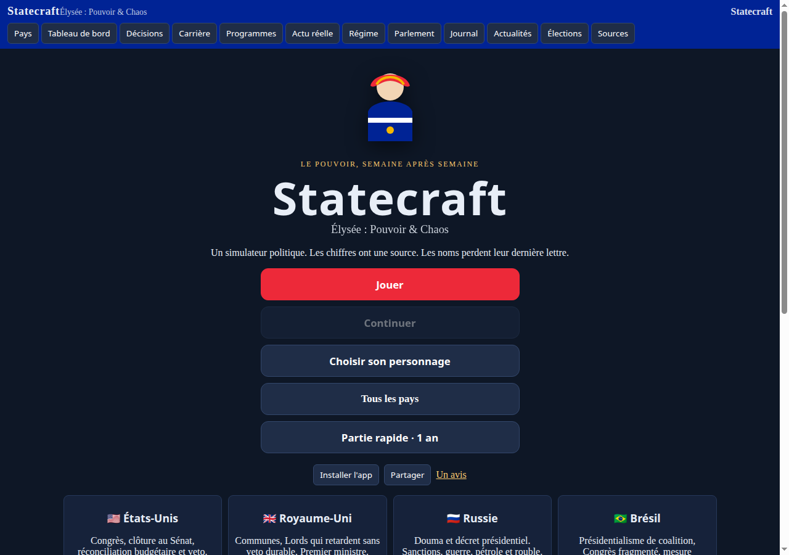
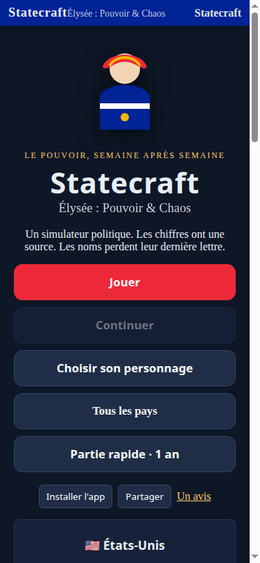
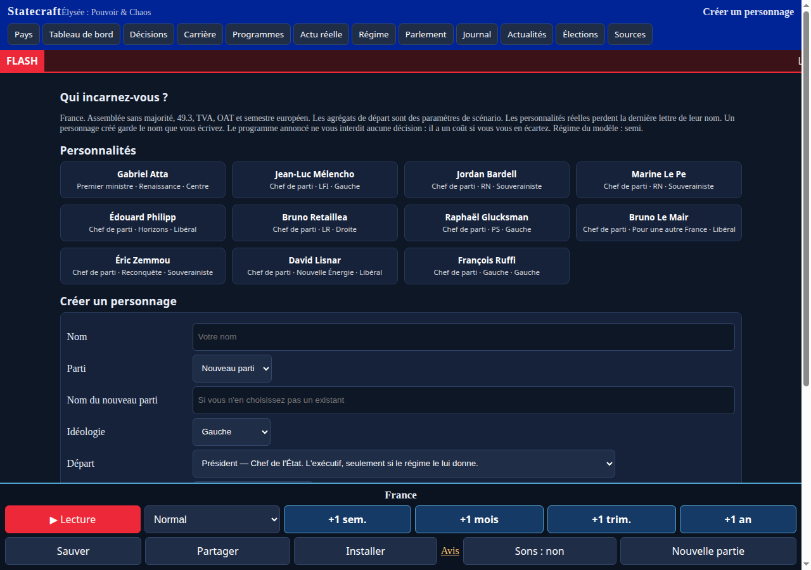

# Statecraft — Élysée : Pouvoir & Chaos

Simulateur politique jouable tout de suite, sans compte.

**En ligne :** [https://simulateur-politique-france.onrender.com](https://simulateur-politique-france.onrender.com)



Sur téléphone, les boutons restent empilés et lisibles. Une fois la partie lancée, la navigation principale passe en bas.





## Jouer

- **Jouer** ouvre la France et le choix du personnage.
- **Continuer** reprend la partie enregistrée dans ce navigateur.
- **Choisir son personnage** : une personnalité réelle (la dernière lettre du nom est enlevée) ou un personnage créé.
- **Partie rapide** dure un an, puis propose un bilan à partager.
- Au premier tableau de bord, une prise en main en quatre étapes (environ une minute) explique le temps, les décisions, les programmes et l'actu.

Les chiffres de départ ont une source, indiquée dans l'onglet Sources. Une estimation est écrite comme telle. Appliquer une mesure de programme montre tout de suite si elle est faisable, difficile ou bloquée.

## Installer et partager

Le bouton **Installer** utilise l'installation du navigateur. Sur iPhone : Partager, puis Sur l'écran d'accueil. **Partager** envoie le lien, ou le copie. En fin de partie rapide, ou de mandat, le bilan se partage en texte avec le lien.

Un avis : [ouvrir une issue](https://github.com/sylvainmucci-rgb/simulateur-politique-france/issues/new).

## En local

```bash
python3 -m http.server
```

Puis ouvrir `http://127.0.0.1:8000`. Sans `?pays=`, l'accueil demande le pays. `?pays=fr` ouvre la France. Les autres fichiers sont `us`, `gb`, `ir`, `il`, `cn`, `ru`, `de`, `br`, `in`, `it`, `jp`, `ca`, `mx`, `es`, `tr`.

Ajouter un pays : créer `data/xx.js` sur le même schéma, l'inclure dans `index.html` et dans `sw.js`, puis augmenter le nom du cache.

Le déploiement Render est un site statique, sans build, depuis `main`.
